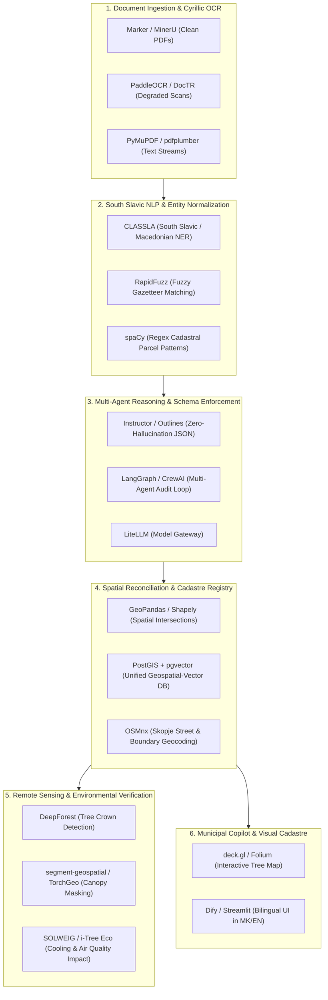

# Open-Source Blueprint: 53 Curated Git Repositories for Track 3 (Skopje Green Cadastre)
*Curated & Categorized for the IEEE Humanitarian Technologies GenAI for Good Challenge*

> [!IMPORTANT]
> **Production Stack Blueprint**: This registry inventories **53 authoritative open-source repositories** required to build an end-to-end, zero-hallucination municipal document intelligence and cadastral reconciliation system for **IEEE Humanitarian Technologies GenAI for Good (Track 3: Safeguarding Green Infrastructure - Skopje)**.

---

## 1. End-to-End System Architecture & Tool Mapping

The diagram below illustrates how these 53 repositories assemble into a modular, production-ready pipeline:

---

## 2. 'The Golden Stack' (Top 6 Repositories to Build the MVP)

If you need to assemble a winning prototype with minimal bloat, use this battle-tested combination:

| Layer | Recommended Repository | Justification |
| :--- | :--- | :--- |
| **OCR & Parsing** | [VikParuchuri/marker](https://github.com/VikParuchuri/marker) | Converts mixed tabular and textual scanned PDFs directly into clean Markdown and structured tables. |
| **Macedonian NLP** | [clarinsi/classla](https://github.com/clarinsi/classla) | The only state-of-the-art NLP library with native pre-trained models specifically for **Macedonian Cyrillic**. |
| **Strict JSON Extraction** | [jxnl/instructor](https://github.com/jxnl/instructor) | Enforces Pydantic schema validation so LLMs cannot hallucinate parcel IDs or tree counts. |
| **Geospatial Processing** | [geopandas/geopandas](https://github.com/geopandas/geopandas) | Enables point-in-polygon queries linking tree locations to cadastral plots (*КП броеви*). |
| **Agent Orchestration** | [langchain-ai/langgraph](https://github.com/langchain-ai/langgraph) | Controls the verification loop (Document Reader $\to$ GIS Validator $\to$ Compliance Auditor). |
| **Map Dashboard** | [opengeos/leafmap](https://github.com/opengeos/leafmap) | Turnkey interactive spatial visualization embedded seamlessly into Python web frameworks. |

---

## 3. Comprehensive Repository Catalog (53 Repositories)

### Pillar 1: Visually-Rich Document AI, OCR & Layout Analysis

#### 1. [PaddleOCR](https://github.com/PaddlePaddle/PaddleOCR) (`PaddlePaddle/PaddleOCR`)
- **Repository Link**: [https://github.com/PaddlePaddle/PaddleOCR](https://github.com/PaddlePaddle/PaddleOCR)
- **Technical Capability**: Ultra-lightweight multi-lingual OCR system with native support for 80+ languages including Cyrillic scripts, layout analysis (PP-Structure), and table extraction.
- **Role in Track 3 (Skopje Green Cadastre)**: Primary candidate for offline, high-speed Macedonian Cyrillic document OCR and stamp detection.

#### 2. [DocTR](https://github.com/mindee/doctr) (`mindee/doctr`)
- **Repository Link**: [https://github.com/mindee/doctr](https://github.com/mindee/doctr)
- **Technical Capability**: Deep learning OCR for documents powered by PyTorch and TensorFlow, featuring text detection (DBNet) and text recognition (CRNN, SAR, Master).
- **Role in Track 3 (Skopje Green Cadastre)**: Parsing multi-page municipal PDF permits into structured text line hierarchies.

#### 3. [Surya](https://github.com/VikParuchuri/surya) (`VikParuchuri/surya`)
- **Repository Link**: [https://github.com/VikParuchuri/surya](https://github.com/VikParuchuri/surya)
- **Technical Capability**: Multilingual document OCR, layout analysis, reading order detection, and line detection toolkit with 90+ language support.
- **Role in Track 3 (Skopje Green Cadastre)**: Determining exact reading order and separating stamps/signatures from official permit text.

#### 4. [Marker](https://github.com/VikParuchuri/marker) (`VikParuchuri/marker`)
- **Repository Link**: [https://github.com/VikParuchuri/marker](https://github.com/VikParuchuri/marker)
- **Technical Capability**: High-accuracy pipeline to convert PDF and scanned documents to Markdown and structured JSON with table preservation.
- **Role in Track 3 (Skopje Green Cadastre)**: Extracting clean markdown representations of administrative regulations and environmental reports.

#### 5. [MinerU (PDF-Extract-Kit)](https://github.com/opendatalab/MinerU) (`opendatalab/MinerU`)
- **Repository Link**: [https://github.com/opendatalab/MinerU](https://github.com/opendatalab/MinerU)
- **Technical Capability**: A one-stop tool for high-quality extraction of complex PDF documents, extracting text, formulas, tables, and visual elements.
- **Role in Track 3 (Skopje Green Cadastre)**: Extracting tabular compensatory planting schedules from official gazettes and municipal orders.

#### 6. [LayoutLM / UniLM](https://github.com/microsoft/unilm) (`microsoft/unilm`)
- **Repository Link**: [https://github.com/microsoft/unilm](https://github.com/microsoft/unilm)
- **Technical Capability**: Multimodal pre-trained models (LayoutLMv1/v2/v3) for visually-rich document understanding incorporating 2D spatial coordinates and visual patches.
- **Role in Track 3 (Skopje Green Cadastre)**: Classifying administrative zones (permit header, cadastral parcel box, arborist signature).

#### 7. [Table Transformer](https://github.com/microsoft/table-transformer) (`microsoft/table-transformer`)
- **Repository Link**: [https://github.com/microsoft/table-transformer](https://github.com/microsoft/table-transformer)
- **Technical Capability**: Deep learning model based on DETR for table detection and table structure recognition in unstructured documents.
- **Role in Track 3 (Skopje Green Cadastre)**: Isolating tabular schedules of trees slated for removal versus replacement saplings.

#### 8. [Nougat](https://github.com/facebookresearch/nougat) (`facebookresearch/nougat`)
- **Repository Link**: [https://github.com/facebookresearch/nougat](https://github.com/facebookresearch/nougat)
- **Technical Capability**: Visual document understanding transformer by Meta AI for parsing scientific and structured documents without standard OCR.
- **Role in Track 3 (Skopje Green Cadastre)**: Translating complex mathematical and statistical environmental filings directly to markup.

#### 9. [DeepDoctection](https://github.com/deepdoctection/deepdoctection) (`deepdoctection/deepdoctection`)
- **Repository Link**: [https://github.com/deepdoctection/deepdoctection](https://github.com/deepdoctection/deepdoctection)
- **Technical Capability**: Orchestration library for document processing pipelines, combining object detection, OCR, table recognition, and token classification.
- **Role in Track 3 (Skopje Green Cadastre)**: End-to-end chaining of PDF rasterization, text localization, and metadata extraction.

#### 10. [Unstructured](https://github.com/Unstructured-IO/unstructured) (`Unstructured-IO/unstructured`)
- **Repository Link**: [https://github.com/Unstructured-IO/unstructured](https://github.com/Unstructured-IO/unstructured)
- **Technical Capability**: Open-source data preprocessing library for ingesting raw unstructured documents (PDF, DOCX, images) into LLM-ready chunks.
- **Role in Track 3 (Skopje Green Cadastre)**: Standardizing ingest pipelines across diverse file types sent by municipal departments.

#### 11. [Tesseract OCR](https://github.com/tesseract-ocr/tesseract) (`tesseract-ocr/tesseract`)
- **Repository Link**: [https://github.com/tesseract-ocr/tesseract](https://github.com/tesseract-ocr/tesseract)
- **Technical Capability**: The gold-standard open-source OCR engine with mature traineddata models for Macedonian (mkd) and Slavic Cyrillic.
- **Role in Track 3 (Skopje Green Cadastre)**: Baseline text extraction for clean, high-DPI scanned legal decrees.

#### 12. [EasyOCR](https://github.com/JaidedAI/EasyOCR) (`JaidedAI/EasyOCR`)
- **Repository Link**: [https://github.com/JaidedAI/EasyOCR](https://github.com/JaidedAI/EasyOCR)
- **Technical Capability**: Ready-to-use optical character recognition with 80+ supported languages and all popular writing scripts, based on PyTorch.
- **Role in Track 3 (Skopje Green Cadastre)**: Rapid spot-verification of cropped stamps and seal bounding boxes.

#### 13. [PyMuPDF](https://github.com/pymupdf/PyMuPDF) (`pymupdf/PyMuPDF`)
- **Repository Link**: [https://github.com/pymupdf/PyMuPDF](https://github.com/pymupdf/PyMuPDF)
- **Technical Capability**: High-performance Python binding for MuPDF, providing fast text extraction, vector rendering, and document manipulation.
- **Role in Track 3 (Skopje Green Cadastre)**: Extracting vector text streams, bounding boxes, and rasterizing high-res TIFF/PDF permit scans.

#### 14. [pdfplumber](https://github.com/jsvine/pdfplumber) (`jsvine/pdfplumber`)
- **Repository Link**: [https://github.com/jsvine/pdfplumber](https://github.com/jsvine/pdfplumber)
- **Technical Capability**: Plumb a PDF for detailed information about each text character, rectangle, and line, with precision table extraction.
- **Role in Track 3 (Skopje Green Cadastre)**: Extracting structured forms from digitally generated municipal PDFs without OCR overhead.

#### 15. [Donut (Document Understanding Transformer)](https://github.com/clovaai/donut) (`clovaai/donut`)
- **Repository Link**: [https://github.com/clovaai/donut](https://github.com/clovaai/donut)
- **Technical Capability**: OCR-free document understanding transformer that maps document images directly into JSON format.
- **Role in Track 3 (Skopje Green Cadastre)**: Direct image-to-JSON parsing of standardized permit templates without multi-step error accumulation.

### Pillar 2: South Slavic / Cyrillic / Multilingual NLP & Entity Linking

#### 16. [CLASSLA](https://github.com/clarinsi/classla) (`clarinsi/classla`)
- **Repository Link**: [https://github.com/clarinsi/classla](https://github.com/clarinsi/classla)
- **Technical Capability**: Specialized NLP fork of Stanza for South Slavic languages (Slovenian, Croatian, Serbian, and Macedonian) developed by CLARIN.SI.
- **Role in Track 3 (Skopje Green Cadastre)**: Named Entity Recognition (NER), lemmatization, and syntactic parsing for Macedonian legal text.

#### 17. [Stanza](https://github.com/stanfordnlp/stanza) (`stanfordnlp/stanza`)
- **Repository Link**: [https://github.com/stanfordnlp/stanza](https://github.com/stanfordnlp/stanza)
- **Technical Capability**: Stanford NLP group's official Python library with neural pipelines for 70+ languages, including native Macedonian.
- **Role in Track 3 (Skopje Green Cadastre)**: Extracting named locations, dates, and administrative parties from permit narratives.

#### 18. [spaCy](https://github.com/explosion/spaCy) (`explosion/spaCy`)
- **Repository Link**: [https://github.com/explosion/spaCy](https://github.com/explosion/spaCy)
- **Technical Capability**: Industrial-strength Natural Language Processing in Python with fast tokenization, pipeline components, and entity rulers.
- **Role in Track 3 (Skopje Green Cadastre)**: Rule-based regex and pattern matching for Cadastral Parcel IDs (e.g. 'КП [0-9]+/[0-9]+').

#### 19. [Transformers (Hugging Face)](https://github.com/huggingface/transformers) (`huggingface/transformers`)
- **Repository Link**: [https://github.com/huggingface/transformers](https://github.com/huggingface/transformers)
- **Technical Capability**: State-of-the-art Machine Learning for Pytorch, TensorFlow, and JAX with Slavic BERT, XLM-RoBERTa, and Cyrillic models.
- **Role in Track 3 (Skopje Green Cadastre)**: Backbone library for running fine-tuned multilingual LLMs and embedding models.

#### 20. [GlotScript](https://github.com/cisnlp/GlotScript) (`cisnlp/GlotScript`)
- **Repository Link**: [https://github.com/cisnlp/GlotScript](https://github.com/cisnlp/GlotScript)
- **Technical Capability**: Efficient script and language identification engine covering over 2,000 languages and writing systems.
- **Role in Track 3 (Skopje Green Cadastre)**: Detecting mixed Cyrillic vs. Latin scripts (e.g. Latin botanical names mixed with Cyrillic text).

#### 21. [BERTopic](https://github.com/MaartenGr/BERTopic) (`MaartenGr/BERTopic`)
- **Repository Link**: [https://github.com/MaartenGr/BERTopic](https://github.com/MaartenGr/BERTopic)
- **Technical Capability**: Leveraging transformers and c-TF-IDF to create easily interpretable topics and semantic document clusters.
- **Role in Track 3 (Skopje Green Cadastre)**: Clustering years of municipal memos into categories: tree pruning, hazardous removal, greenways.

#### 22. [Polyglot](https://github.com/aboSamoor/polyglot) (`aboSamoor/polyglot`)
- **Repository Link**: [https://github.com/aboSamoor/polyglot](https://github.com/aboSamoor/polyglot)
- **Technical Capability**: Multilingual natural language pipeline supporting massive language catalogs for morphological and entity tasks.
- **Role in Track 3 (Skopje Green Cadastre)**: Morphological analysis of Slavic plant genus inflections.

#### 23. [RapidFuzz](https://github.com/rapidfuzz/RapidFuzz) (`rapidfuzz/RapidFuzz`)
- **Repository Link**: [https://github.com/rapidfuzz/RapidFuzz](https://github.com/rapidfuzz/RapidFuzz)
- **Technical Capability**: Rapid fuzzy string matching in Python and C++, utilizing the Levenshtein Distance for noisy OCR resolution.
- **Role in Track 3 (Skopje Green Cadastre)**: Resolving misspelled street names and tree species caused by OCR degradation against reference gazetteers.

### Pillar 3: Urban Forestry, Tree Canopy & Remote Sensing

#### 24. [DeepForest](https://github.com/weecology/DeepForest) (`weecology/DeepForest`)
- **Repository Link**: [https://github.com/weecology/DeepForest](https://github.com/weecology/DeepForest)
- **Technical Capability**: Python package for individual tree crown detection in airborne RGB and multispectral imagery using deep learning.
- **Role in Track 3 (Skopje Green Cadastre)**: Detecting tree crowns in high-res aerial imagery to verify reported tree locations against reality.

#### 25. [segment-geospatial](https://github.com/opengeos/segment-geospatial) (`opengeos/segment-geospatial`)
- **Repository Link**: [https://github.com/opengeos/segment-geospatial](https://github.com/opengeos/segment-geospatial)
- **Technical Capability**: Segment Anything Model (SAM) applied to geospatial data for pixel-level boundary extraction of buildings and canopies.
- **Role in Track 3 (Skopje Green Cadastre)**: Segmenting urban tree canopies and green parcels directly from orthophotos of Skopje.

#### 26. [TorchGeo](https://github.com/microsoft/torchgeo) (`microsoft/torchgeo`)
- **Repository Link**: [https://github.com/microsoft/torchgeo](https://github.com/microsoft/torchgeo)
- **Technical Capability**: PyTorch domain library for geospatial data, integrating datasets, samplers, and pre-trained models for Earth observation.
- **Role in Track 3 (Skopje Green Cadastre)**: Training multispectral vegetation classification and land cover models.

#### 27. [leafmap](https://github.com/opengeos/leafmap) (`opengeos/leafmap`)
- **Repository Link**: [https://github.com/opengeos/leafmap](https://github.com/opengeos/leafmap)
- **Technical Capability**: Comprehensive Python package for interactive geospatial analysis and visualization in Jupyter and web apps.
- **Role in Track 3 (Skopje Green Cadastre)**: Building interactive Green Cadastre visual inspection interfaces for municipal planners.

#### 28. [geemap](https://github.com/gee-community/geemap) (`gee-community/geemap`)
- **Repository Link**: [https://github.com/gee-community/geemap](https://github.com/gee-community/geemap)
- **Technical Capability**: Python package for interactive mapping with Google Earth Engine (GEE), ipyleaflet, and folium.
- **Role in Track 3 (Skopje Green Cadastre)**: Pulling historical NDVI (Normalized Difference Vegetation Index) time series to audit tree loss over time.

#### 29. [Urban Canopy Modeling (SOLWEIG)](https://github.com/UMEP-dev/SOLWEIG) (`UMEP-dev/SOLWEIG`)
- **Repository Link**: [https://github.com/UMEP-dev/SOLWEIG](https://github.com/UMEP-dev/SOLWEIG)
- **Technical Capability**: Solar and LongWave Environmental Irradiance Geometry model for estimating 3D radiation and urban thermal comfort.
- **Role in Track 3 (Skopje Green Cadastre)**: Quantifying microclimate and heat-island reduction benefits when replanting compensatory trees.

#### 30. [OpenTreeData](https://github.com/UrbanForestry/OpenTreeData) (`UrbanForestry/OpenTreeData`)
- **Repository Link**: [https://github.com/UrbanForestry/OpenTreeData](https://github.com/UrbanForestry/OpenTreeData)
- **Technical Capability**: Open database and schemas for municipal tree inventory data collection and standardization.
- **Role in Track 3 (Skopje Green Cadastre)**: Reference schema for structuring Skopje's Green Cadastre tree attributes (DBH, health, species).

#### 31. [i-Tree Eco Tools](https://github.com/i-tree/eco) (`i-tree/eco`)
- **Repository Link**: [https://github.com/i-tree/eco](https://github.com/i-tree/eco)
- **Technical Capability**: USDA Forest Service tools for assessing urban forest structure and quantifying ecosystem services and pollution removal.
- **Role in Track 3 (Skopje Green Cadastre)**: Automating environmental impact calculations (particulate absorption in Skopje's air) from tree data.

#### 32. [Forest-3D](https://github.com/cag/forest3d) (`cag/forest3d`)
- **Repository Link**: [https://github.com/cag/forest3d](https://github.com/cag/forest3d)
- **Technical Capability**: Python library for 3D modeling and geometric reconstruction of individual tree crowns and stems.
- **Role in Track 3 (Skopje Green Cadastre)**: Calculating accurate biomass and physical space constraints for urban tree replacement planning.

#### 33. [TreeLS](https://github.com/tiagodc/TreeLS) (`tiagodc/TreeLS`)
- **Repository Link**: [https://github.com/tiagodc/TreeLS](https://github.com/tiagodc/TreeLS)
- **Technical Capability**: Terrestrial Laser Scanning (TLS) point cloud processing for forestry and tree stem diameter extraction.
- **Role in Track 3 (Skopje Green Cadastre)**: Calibrating ground-truth tree measurements (diameter at breast height) against permit claims.

### Pillar 4: Geospatial Engineering, Cadastre & GIS Infrastructure

#### 34. [GeoPandas](https://github.com/geopandas/geopandas) (`geopandas/geopandas`)
- **Repository Link**: [https://github.com/geopandas/geopandas](https://github.com/geopandas/geopandas)
- **Technical Capability**: Extends pandas data structures to allow spatial operations on geometric types (points, polygons, multipolygons).
- **Role in Track 3 (Skopje Green Cadastre)**: Core engine for loading cadastral parcel shapefiles, performing point-in-polygon queries for trees.

#### 35. [OSMnx](https://github.com/gboeing/osmnx) (`gboeing/osmnx`)
- **Repository Link**: [https://github.com/gboeing/osmnx](https://github.com/gboeing/osmnx)
- **Technical Capability**: Python package to easily download, model, analyze, and visualize street networks and geospatial data from OpenStreetMap.
- **Role in Track 3 (Skopje Green Cadastre)**: Geocoding street addresses and municipal boundaries in Skopje (Centar, Karposh, Aerodrom).

#### 36. [Shapely](https://github.com/shapely/shapely) (`shapely/shapely`)
- **Repository Link**: [https://github.com/shapely/shapely](https://github.com/shapely/shapely)
- **Technical Capability**: Manipulation and analysis of planar geometric objects based on GEOS engine.
- **Role in Track 3 (Skopje Green Cadastre)**: Spatial intersection tests to check if a tree coordinate falls within a legally protected parcel.

#### 37. [Fiona](https://github.com/Toblerity/Fiona) (`Toblerity/Fiona`)
- **Repository Link**: [https://github.com/Toblerity/Fiona](https://github.com/Toblerity/Fiona)
- **Technical Capability**: Fiona reads and writes geographic data files (Shapefile, GeoJSON, GeoPackage) using GDAL.
- **Role in Track 3 (Skopje Green Cadastre)**: Streaming large municipal cadastral vector datasets into memory without memory overflow.

#### 38. [Rasterio](https://github.com/rasterio/rasterio) (`rasterio/rasterio`)
- **Repository Link**: [https://github.com/rasterio/rasterio](https://github.com/rasterio/rasterio)
- **Technical Capability**: Fast and clean geospatial raster I/O for Python based on GDAL.
- **Role in Track 3 (Skopje Green Cadastre)**: Overlaying tree coordinates onto multispectral aerial orthophotos of North Macedonia.

#### 39. [PostGIS](https://github.com/postgis/postgis) (`postgis/postgis`)
- **Repository Link**: [https://github.com/postgis/postgis](https://github.com/postgis/postgis)
- **Technical Capability**: Spatial database extender for PostgreSQL object-relational database with robust indexing (R-Tree/GiST).
- **Role in Track 3 (Skopje Green Cadastre)**: Production database backend hosting the authoritative Skopje Green Cadastre.

#### 40. [pgvector](https://github.com/pgvector/pgvector) (`pgvector/pgvector`)
- **Repository Link**: [https://github.com/pgvector/pgvector](https://github.com/pgvector/pgvector)
- **Technical Capability**: Open-source vector similarity search extension for PostgreSQL, supporting exact and approximate nearest neighbor search.
- **Role in Track 3 (Skopje Green Cadastre)**: Storing document chunk embeddings alongside spatial geometries in a single unified PostGIS database.

#### 41. [GDAL (Geospatial Data Abstraction Library)](https://github.com/OSGeo/gdal) (`OSGeo/gdal`)
- **Repository Link**: [https://github.com/OSGeo/gdal](https://github.com/OSGeo/gdal)
- **Technical Capability**: Translator library for raster and vector geospatial data formats used across all modern GIS systems.
- **Role in Track 3 (Skopje Green Cadastre)**: Coordinate transformation between Macedonian National Grid (MGI / Balkans zone 7, EPSG:31277) and WGS84 (EPSG:4326).

#### 42. [deck.gl](https://github.com/visgl/deck.gl) (`visgl/deck.gl`)
- **Repository Link**: [https://github.com/visgl/deck.gl](https://github.com/visgl/deck.gl)
- **Technical Capability**: WebGL-powered framework for visual exploratory data analysis of large-scale datasets.
- **Role in Track 3 (Skopje Green Cadastre)**: High-performance browser rendering of 100,000+ urban trees with instant filtering by permit status.

#### 43. [Folium](https://github.com/python-visualization/folium) (`python-visualization/folium`)
- **Repository Link**: [https://github.com/python-visualization/folium](https://github.com/python-visualization/folium)
- **Technical Capability**: Python data manipulation and Leaflet.js mapping visualization.
- **Role in Track 3 (Skopje Green Cadastre)**: Rapid prototyping of interactive web maps directly embedded in Streamlit municipal dashboards.

### Pillar 5: Multi-Agent Systems, Structured Output & Zero-Hallucination Frameworks

#### 44. [Instructor](https://github.com/jxnl/instructor) (`jxnl/instructor`)
- **Repository Link**: [https://github.com/jxnl/instructor](https://github.com/jxnl/instructor)
- **Technical Capability**: Structured extraction for LLMs powered by Pydantic. Enforces strict schema output, validation, and auto-retries.
- **Role in Track 3 (Skopje Green Cadastre)**: Guaranteed zero-hallucination JSON extraction of tree permits with validated cadastral numbers.

#### 45. [Outlines](https://github.com/outlines-dev/outlines) (`outlines-dev/outlines`)
- **Repository Link**: [https://github.com/outlines-dev/outlines](https://github.com/outlines-dev/outlines)
- **Technical Capability**: Structured text generation with regular expressions, context-free grammars, and JSON schemas for LLMs.
- **Role in Track 3 (Skopje Green Cadastre)**: Constraining local open-source LLM outputs strictly to Macedonian administrative JSON schemas.

#### 46. [Guidance](https://github.com/guidance-ai/guidance) (`guidance-ai/guidance`)
- **Repository Link**: [https://github.com/guidance-ai/guidance](https://github.com/guidance-ai/guidance)
- **Technical Capability**: A guidance language for controlling large language models with interleaved generation and prompt control.
- **Role in Track 3 (Skopje Green Cadastre)**: Enforcing step-by-step reasoning when auditing complex multi-page legal disputes.

#### 47. [LangGraph](https://github.com/langchain-ai/langgraph) (`langchain-ai/langgraph`)
- **Repository Link**: [https://github.com/langchain-ai/langgraph](https://github.com/langchain-ai/langgraph)
- **Technical Capability**: Build resilient language agents as cyclical state machines and multi-agent workflows.
- **Role in Track 3 (Skopje Green Cadastre)**: Orchestrating the tri-agent loop: Ingest Agent -> Cadastre Lookup Agent -> Compliance Auditor.

#### 48. [AutoGen](https://github.com/microsoft/autogen) (`microsoft/autogen`)
- **Repository Link**: [https://github.com/microsoft/autogen](https://github.com/microsoft/autogen)
- **Technical Capability**: Multi-agent conversation framework to enable next-generation LLM applications with autonomous cooperation.
- **Role in Track 3 (Skopje Green Cadastre)**: Simulating multi-departmental review (City Planning Officer vs. Environmental Inspector).

#### 49. [CrewAI](https://github.com/crewAIInc/crewAI) (`crewAIInc/crewAI`)
- **Repository Link**: [https://github.com/crewAIInc/crewAI](https://github.com/crewAIInc/crewAI)
- **Technical Capability**: Cutting-edge framework for orchestrating role-playing, autonomous AI agents.
- **Role in Track 3 (Skopje Green Cadastre)**: Assembling specialized agents: OCR Specialist, Cadastral Validator, Environmental Compliance Officer.

#### 50. [LlamaIndex](https://github.com/run-llama/llama_index) (`run-llama/llama_index`)
- **Repository Link**: [https://github.com/run-llama/llama_index](https://github.com/run-llama/llama_index)
- **Technical Capability**: Data framework for LLM-based applications, specializing in ingestion, indexing, and Retrieval-Augmented Generation (RAG).
- **Role in Track 3 (Skopje Green Cadastre)**: Indexing historical Macedonian municipal archives and gazettes for citation-backed retrieval.

#### 51. [LiteLLM](https://github.com/BerriAI/litellm) (`BerriAI/litellm`)
- **Repository Link**: [https://github.com/BerriAI/litellm](https://github.com/BerriAI/litellm)
- **Technical Capability**: Unified API interface to call 100+ LLM APIs using OpenAI format with fallbacks, rate limiting, and observability.
- **Role in Track 3 (Skopje Green Cadastre)**: Seamlessly switching between Gemini 2.0, Claude 3.5, and local Ollama/vLLM backbones.

#### 52. [Dify](https://github.com/langgenius/dify) (`langgenius/dify`)
- **Repository Link**: [https://github.com/langgenius/dify](https://github.com/langgenius/dify)
- **Technical Capability**: Open-source LLM app development platform combining AI workflow orchestration, RAG engine, and agent capabilities.
- **Role in Track 3 (Skopje Green Cadastre)**: Providing a turnkey visual workflow UI for municipal operators to manage prompt pipelines.

#### 53. [Firecrawl](https://github.com/mendableai/firecrawl) (`mendableai/firecrawl`)
- **Repository Link**: [https://github.com/mendableai/firecrawl](https://github.com/mendableai/firecrawl)
- **Technical Capability**: Turn entire websites and digital archives into clean Markdown for LLMs with crawling, scraping, and document extraction.
- **Role in Track 3 (Skopje Green Cadastre)**: Automating continuous scraping of public municipal gazettes and official announcements from Skopje portal.

